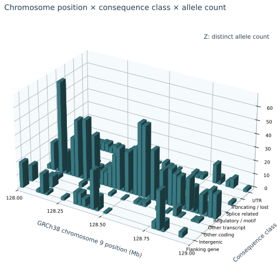
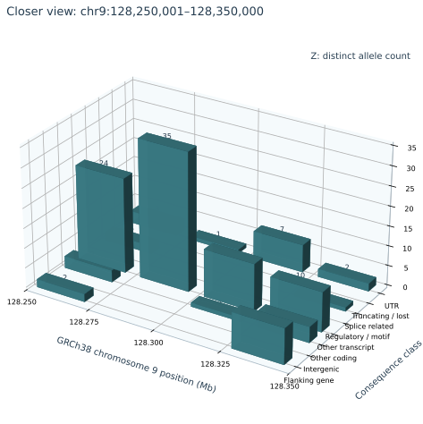

# HG002 Chromosome 9 Variant Annotation

**A reproducible study of how transcript choice changes the predicted effect of a DNA variant.**

The project combines validated public HG002 calls, authentic Ensembl VEP annotations and a dated ClinVar overlay. It preserves the evidence behind each result and explains why the same DNA change can receive different annotations across a gene’s RNA transcripts.

**Completed scope:** GRCh38 chromosome 9, bases **128,000,001–129,000,000**. This is a one-million-base benchmark interval, not a completed whole-chromosome or population study.

## Read the report

- **[Complete PDF report](reports/experiment-report.pdf)** — 3D results on page 2, methods, results, five scientific figures including two 3D views, four case studies, limitations and future work.
- **[Standalone HTML report](reports/experiment-report.html)** — the same account with embedded styling and figures; opens without a server.
- **[Download the sharing package](reports/variant-annotation-report.zip)** — HTML, PDF and report provenance together.

The reports are the finished presentation of this project. They include a glossary and explain both what was observed and why it matters.

## What the experiment found

| Observation | Result | Meaning |
| --- | ---: | --- |
| Eligible HG002 alleles | **1,307** | 1,076 single-base substitutions and 231 short insertions/deletions |
| Transcript annotation rows | **38,589** | One allele can affect many transcripts; these are not independent people or variant calls |
| Allele–gene pairs with differing transcript consequences | **1,081 / 2,170** | A single transcript summary can conceal annotation differences |
| Representative transcript omits a more severe same-gene term | **183 / 2,170** | A standard representative supports consistency but does not replace reviewing alternatives |
| Exact eligible ClinVar matches | **116** | Dated source assertions were matched by normalized allele identity |
| No exact eligible ClinVar match | **1,191** | No match in the fixed release is not evidence of benignity |
| High-confidence benchmark bases | **886,920** | Genomic counts are interpreted with the matching coverage denominator |

All 1,307 included alleles passed reference checking and received a valid VEP response. Twenty-two had no reported transcript overlap and were retained explicitly. The study annotates already-called variants; it does not perform variant calling or estimate calling accuracy.

## Three-dimensional results

### The complete analyzed interval



**Read the axes:** X is chromosome 9 position in megabases, Y groups the provider’s predicted consequence, and Z counts distinct alleles in each 25 kb region/class. Each allele appears once; the bars sum to **1,307**. Taller bars mean more observed alleles, not greater disease risk. Shading shows geometry rather than clinical severity.

### A closer look around two case-study loci



This close-up covers **chr9:128,250,001–128,350,000**, containing **116 alleles already included in the full analysis**. It makes smaller consequence groups easier to inspect. Its vertical scale differs from the overview, so compare the numerical counts rather than apparent heights between figures.

The report pairs these 3D views with precise 2D figures and evidence tables. PDF figures are static; interactive selection is available in the local explorer after data acquisition.

## Cases that explain the result

| Case | Observed transcript evidence | Why it matters |
| --- | --- | --- |
| **COQ4** — `9:128323094:G:C` | Missense on the representative; an alternative adds an NMD transcript context | A predicted amino-acid change alone does not establish clinical significance |
| **GOLGA2** — `9:128258516:GCCT:G` | In-frame deletion on the representative versus a UTR/NMD annotation on an alternative | Transcript structure changes the description; dated ClinVar conflicts remain visible |
| **SPTAN1** — `9:128632018:A:G` | Intronic on MANE Select versus splice-acceptor/noncoding on an alternative | A more severe term on another model requires transcript-context review |
| **Missing evidence** — `9:128012473:T:C` | A downstream annotation with missing gene symbol and HGVS | Identifiers and missing fields are preserved; values are not invented |

Exact transcript accessions, HGVS, source rows, clinical-source review status and conditions are included in the full report.

## How the study was performed

1. **Validate the workflow.** Five public Ensembl teaching variants establish reference checks, indel reconciliation and regression cases, separately from HG002 totals.
2. **Fix the experiment.** Select a contiguous 1 Mb interval before examining consequences; pin GIAB HG002 NIST v4.2.1 GRCh38 and its matching high-confidence BED.
3. **Prepare alleles.** Extract by index, split sample-present ALT alleles, retain origin records, verify full REF spans, normalize with bcftools 1.21 and deduplicate by chromosome/position/REF/ALT.
4. **Annotate authentically.** Use 14 bounded Ensembl REST batches, retaining all reported transcripts, exact requests, untouched output, timestamps, hashes and resumable fingerprints.
5. **Compare transcripts.** Select MANE Select, then canonical, then a deterministic fallback per allele–gene pair. Compare term sets and the pinned Ensembl molecular-severity ranking.
6. **Add dated evidence.** Normalize eligible ClinVar GRCh38 alleles consistently and accept exact matches only; preserve assertions, conditions, review status and conflicts.
7. **Reconcile and communicate.** Check processing totals, raw/source rows, deterministic exports and reports; present explanatory results, 2D/3D figures and an accessible explorer.

Software/data releases are retained for scientific reproducibility: **Ensembl database 116**, **GIAB NIST v4.2.1**, **ClinVar 2026-11-08**, and **GRCh38**. A separate VEP engine version was not reported. These identify the scientific sources, not alternative project editions.

## Reproduce locally

Python 3.10+ is required. Run from the repository root:

```sh
python3 -m venv analysis/.venv
analysis/.venv/bin/python -m pip install -r analysis/requirements.txt

# Acquire public inputs, verify/normalize them, then annotate the bounded pilot.
analysis/.venv/bin/python analysis/pipeline.py acquire
analysis/.venv/bin/python analysis/pipeline.py prepare
analysis/.venv/bin/python analysis/pipeline.py annotate

# Acquire and normalize the fixed clinical-source overlay.
analysis/.venv/bin/python analysis/clinvar.py acquire
analysis/.venv/bin/python analysis/clinvar.py overlay

# Build the evidence exports and local explorer.
analysis/.venv/bin/python analysis/pipeline.py analyze
analysis/.venv/bin/python analysis/pipeline.py render
analysis/.venv/bin/python analysis/pipeline.py verify
```

Large source inputs, raw snapshots and per-allele explorer assets are excluded from Git. A fresh clone includes the finished reports and source; **run acquisition before using the interactive explorer or rebuilding its scientific exports**. The five-example validation can be reproduced with `python3 validation/run.py fetch`, `report` and `verify`.

After rebuilding, serve locally:

```sh
python3 -m http.server 8000 --bind 127.0.0.1
```

Open **http://127.0.0.1:8000/analysis/report/index.html**. Filters update automatically, the default 2D view uses a fixed scale, and an explanation describes the selected subset. The optional 3D view is loaded on request. All runtime assets are local.

See [pipeline documentation](analysis/README.md) and the [data dictionary](analysis/DATA_DICTIONARY.md) for exact rules, schemas and report-generation commands.

## Checks

Eleven pipeline tests and five teaching-example regression tests passed. Verification covers reference alleles, full input identity, same-position different alleles, multiallelic provenance, interval edges, processing totals, transcript selection, clinical-source matches, hashes and deterministic offline rebuilding.

Chromium checks cover automatic filters, combined selections, reset, keyboard operation, valid zero-transcript alleles, 390 px layout and WebGL failure. The shareable HTML opens offline; PDF text boundaries and figures were checked. Safari/WebKit verification was unavailable because the matching executable was not installed. This is not a formal accessibility certification.

```sh
analysis/.venv/bin/python -m unittest discover -s analysis/tests -v
python3 -m unittest discover -s validation/tests -v
```

## Limitations and future work

**Whole-chromosome annotation remains incomplete.** The standard GRCh38 cache archive exceeded initially available local storage, Docker’s daemon was unavailable, and no offline VEP/cache installation was present. The full offline backend and chromosome-scale verification require additional infrastructure and implementation. The REST workload is deliberately limited to this pilot.

Next steps are provisioned offline chromosome annotation, measured whole-genome scaling, matched public-sample comparisons, a separate representation-aware calling benchmark, condition-specific clinical evidence review and release-drift auditing.

Predicted molecular consequences and dated database assertions do not establish clinical significance or patient outcomes. This is an educational analysis of public data, with no patient metadata, clinical endorsement or NHS-affiliation claim.

## Sources and reuse

- [NIST Genome in a Bottle](https://www.nist.gov/programs-projects/genome-bottle)
- [Fixed HG002 GRCh38 benchmark release](https://ftp-trace.ncbi.nlm.nih.gov/ReferenceSamples/giab/release/AshkenazimTrio/HG002_NA24385_son/NISTv4.2.1/GRCh38/HG002_GRCh38_1_22_v4.2.1_benchmark.vcf.gz)
- [Ensembl REST VEP documentation](https://rest.ensembl.org/documentation/info/vep_region_post)
- [Pinned Ensembl consequence definitions](https://github.com/Ensembl/ensembl-variation/blob/release/116/modules/Bio/EnsEMBL/Variation/Utils/Constants.pm)
- [Dated ClinVar GRCh38 release](https://ftp.ncbi.nlm.nih.gov/pub/clinvar/vcf_GRCh38/archive_2.0/2026/clinvar_20261108.vcf.gz)
- [Ensembl training walkthrough](https://training.ensembl.org/text_module/human_vep_walkthrough)

Upstream datasets retain their own terms; no code licence is applied to them. Raw snapshots remain local pending redistribution review. Bundled Three.js retains its MIT licence. The reports present selected observed results with citations. Nothing has been pushed or published by this workflow.
